# Ahorro energético medido

**Le dice a un pequeño negocio qué cambio hacer primero para pagar menos luz, y después le muestra, con sus propias facturas, cuánto le ahorró de verdad.**

[](https://github.com/ricardobing/ahorro-energetico-medido/actions/workflows/ci.yml)


> Prototipo hecho para el reto técnico de **Agora Partnerships** sobre su plataforma **Kamai**. No es un producto oficial: la marca aparece como texto para ubicar el prototipo en el producto real. Todos los nombres, montos y datos son ficticios.

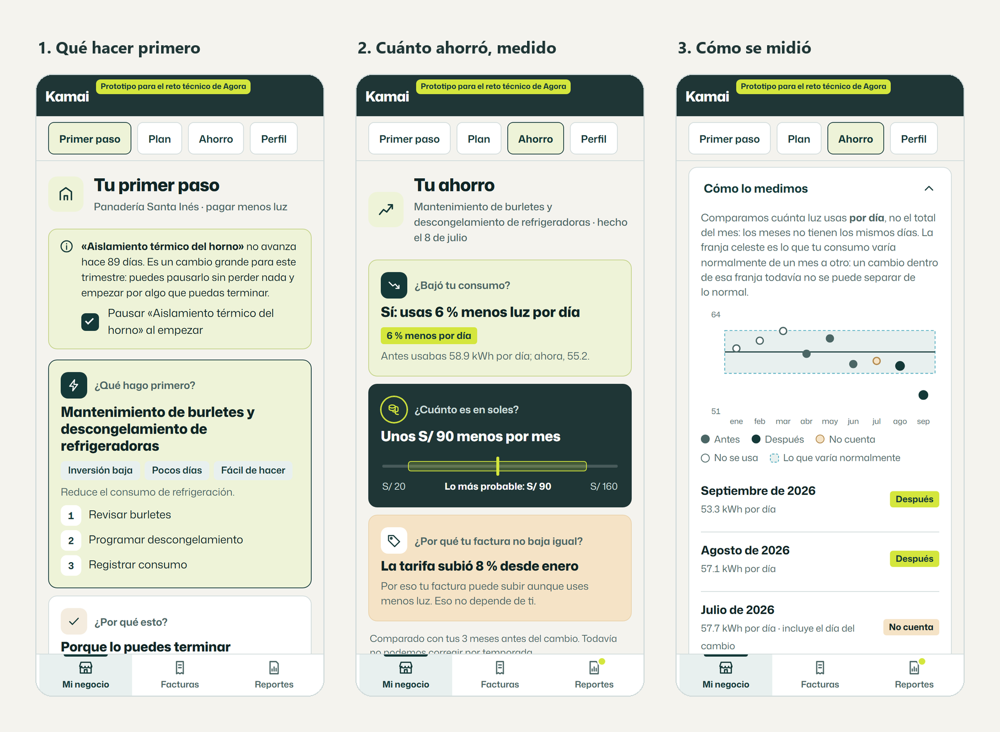

## Contenido

- [El problema que resuelve](#el-problema-que-resuelve)
- [Qué hace](#qué-hace)
- [El recorrido, pantalla por pantalla](#el-recorrido-pantalla-por-pantalla)
- [Cómo funciona por dentro](#cómo-funciona-por-dentro)
- [Instalación y uso](#instalación-y-uso)
- [Guion de prueba en 8 pasos](#guion-de-prueba-en-8-pasos)
- [Arquitectura y tecnologías](#arquitectura-y-tecnologías)
- [Cómo se prueba](#cómo-se-prueba)
- [La especificación (OpenSpec)](#la-especificación-openspec)
- [Qué es real, simulado y sintético](#qué-es-real-simulado-y-sintético)
- [Límites y próximos pasos](#límites-y-próximos-pasos)
- [Cómo se construyó](#cómo-se-construyó)

## El problema que resuelve

Kamai ayuda a pequeños negocios de Latinoamérica a bajar sus costos con *ecoinnovaciones*: cambios concretos en energía, agua o residuos. Tiene un catálogo de más de 40 y guarda las facturas que sube cada negocio, pero **no sabe decirle a una dueña por cuál empezar ni demostrarle cuánto le ahorró la que ya hizo**.

El caso de referencia es **Inés**, dueña de una panadería en Arequipa (Perú). Tiene 6 personas, un horno eléctrico y dos refrigeradoras, y este trimestre puede poner S/ 1.200 y unas 4 horas por semana. Su pregunta es simple: *«¿Qué hago primero para pagar menos luz, y cómo sé si funcionó?»*. Hoy la respuesta le falla de tres maneras:

1. **Le recomendaron algo que no puede terminar.** Eligió «Aislamiento térmico del horno», de inversión y complejidad alta, porque fue lo primero que vio. Lleva siete semanas sin avanzar. El único dato a su favor era un caso de otra panadería con −18 %.
2. **El «ahorro» que le muestran es la resta de dos facturas, y engaña.** En febrero le dijeron «ahorraste S/ 117». Pero febrero tuvo tres días menos que enero: **por día, consumió 1,7 % más**. Con esa resta, en sus seis meses le habrían dicho «ahorraste» tres veces sin que hiciera ningún cambio.
3. **La tarifa se mezcla con su consumo.** Entre enero y junio el precio del kWh subió 8 %, así que su factura puede subir aunque use menos luz.

| Mes | Días | kWh | kWh por día | S/ por kWh | Total S/ | Lo que dice la resta simple |
|---|---:|---:|---:|---:|---:|---|
| Enero | 31 | 1.840 | 59,4 | 0,78 | 1.435 | — |
| Febrero | 28 | 1.690 | **60,4** | 0,78 | 1.318 | «ahorraste S/ 117» (falso: por día usó más) |
| Marzo | 31 | 1.910 | 61,6 | 0,81 | 1.547 | |
| Abril | 30 | 1.760 | 58,7 | 0,81 | 1.426 | «ahorraste S/ 121» |
| Mayo | 31 | 1.880 | 60,6 | 0,81 | 1.523 | |
| Junio | 30 | 1.720 | 57,3 | **0,84** | 1.445 | «ahorraste S/ 78» |

Para el programa, el problema es el mismo a escala. Hoy, de cada 10 negocios que eligen una ecoinnovación, 3 la completan y solo 1 deja facturas de antes y de después. **La meta es que cada negocio vea un ahorro real en sus primeros 90 días y que los aliados que financian el programa reciban ahorro medido, no declarado.**

## Qué hace

**1. Recomienda un primer paso que el negocio pueda terminar.**
- Filtra por las restricciones reales del negocio: objetivo, rubro, equipos, presupuesto, horas por semana, nivel de diagnóstico y planes que ya tiene.
- Ordena por la probabilidad de que lo complete multiplicada por el efecto esperado, con los dos valores **contraídos** hacia una referencia conservadora para que un caso único no mande.
- Lo explica con **motivos verdaderos** («7 de cada 9 panaderías que la eligieron la terminaron») y dice lo que todavía no se sabe. Nunca inventa montos.
- Ofrece pausar el plan estancado y deja elegir otra alternativa, sin pedir explicaciones.
- Guarda la recomendación con su porqué, y las cuatro partes de Kamai que hoy recomiendan cosas distintas pasan a mostrar la misma.

**2. Mide el ahorro sin engañar.**
- Compara **kWh por día**, no totales del mes.
- Primero contra los mismos meses del año anterior; si no los hay, contra los meses cercanos, y lo dice.
- La factura que contiene el día del cambio **no cuenta**.
- Usa cuánto varía normalmente el consumo de *ese* negocio para decidir si un cambio es real.
- Tiene tres resultados: **medido**, **todavía no podemos saberlo** (con el motivo y la fecha de la próxima factura) y **no vemos ahorro**.
- Valoriza a la tarifa de hoy y **muestra el efecto de la tarifa aparte**.
- Se recalcula entero con cada cambio, con versión y huella, sin contar nada dos veces. Si cambia una cifra que la usuaria ya vio, le avisa por qué.

**3. Informa a los aliados solo con datos agregados.**
- Un número aparece solo si viene de **5 negocios o más**. Con menos dice «menos de 5 negocios», y oculta también lo que permitiría deducirlo restando.
- Separa lo medido con facturas de lo declarado en un formulario, y lo desglosa por nivel de evidencia, método y moneda, con equivalente en USD.
- Cierra cada trimestre: el informe cerrado no cambia, y las correcciones posteriores aparecen como ajuste en el siguiente.

**4. Funciona con poco.**
- Pensada para celular con datos limitados: 120 KB o menos de JavaScript inicial y fotos comprimidas en el teléfono a 250 KB o menos.
- Si se corta la conexión, la factura queda guardada en el teléfono.
- Si la foto sale oscura o movida, avisa en el momento y deja guardarla igual.
- Si la IA, el correo o el tipo de cambio fallan, lo esencial sigue andando.

<p align="center">
  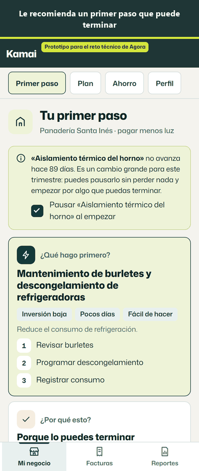
</p>

## El recorrido, pantalla por pantalla

Con la demostración se ve el recorrido completo de Inés en pocos minutos: el botón «Simular el paso del tiempo» hace llegar sus facturas de julio a septiembre.

<table>
  <tr>
    <td align="center" valign="top" width="33%">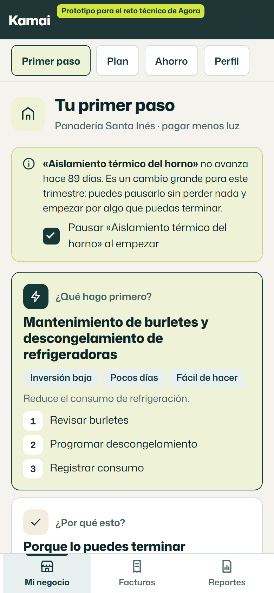<br><b>Tu primer paso</b><br>La recomendación, con su inversión, tiempo y pasos. Arriba, el plan trabado hace 89 días, que se puede pausar sin perder nada.</td>
    <td align="center" valign="top" width="33%">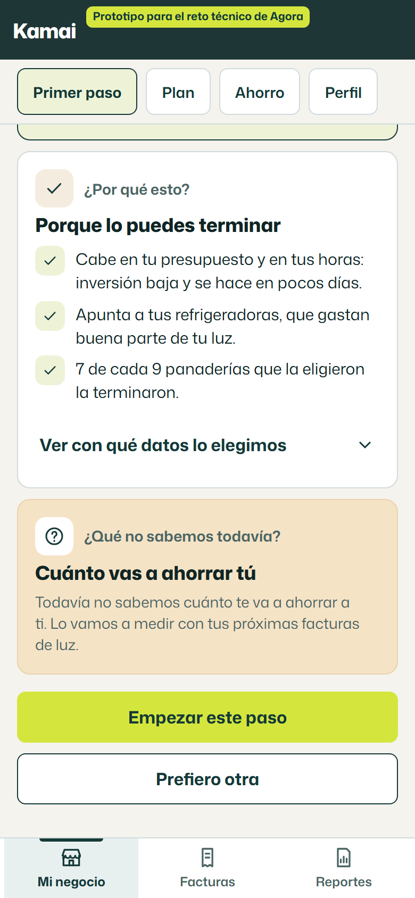<br><b>¿Por qué esto?</b><br>Tres motivos verdaderos, los datos usados y lo que todavía no sabemos. Sin montos inventados.</td>
    <td align="center" valign="top" width="33%">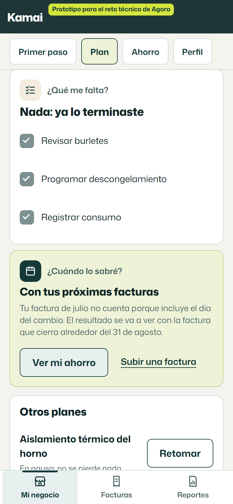<br><b>Tu plan</b><br>Al terminar, pide la fecha y avisa qué factura no cuenta y cuándo se va a ver el resultado.</td>
  </tr>
  <tr>
    <td align="center" valign="top">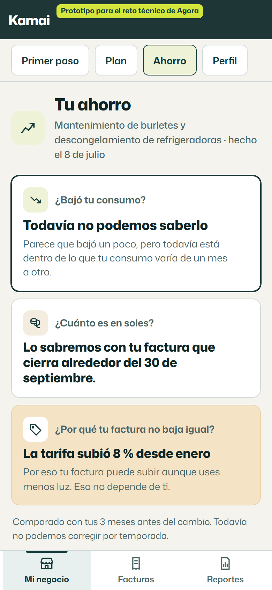<br><b>Todavía no</b><br>Con una sola factura nueva, el cambio está dentro de lo que su consumo varía normalmente: lo dice, y dice cuándo lo sabremos.</td>
    <td align="center" valign="top">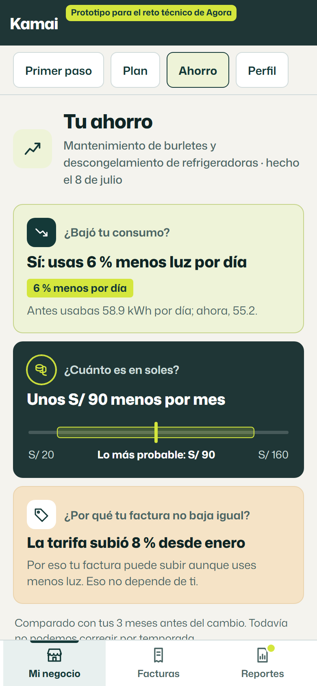<br><b>Ahorro medido</b><br>6 % menos luz por día, unos S/ 90 al mes (entre S/ 20 y S/ 160). La tarifa va aparte.</td>
    <td align="center" valign="top">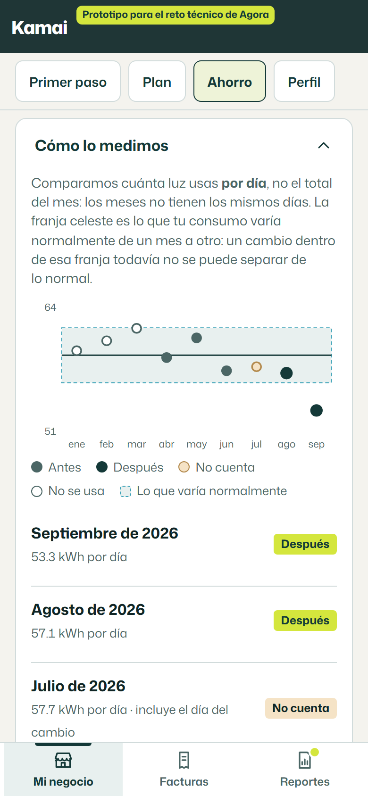<br><b>Cómo lo medimos</b><br>Consumo por día de cada factura, con la franja de lo normal. Julio no cuenta porque incluye el día del cambio.</td>
  </tr>
  <tr>
    <td align="center" valign="top">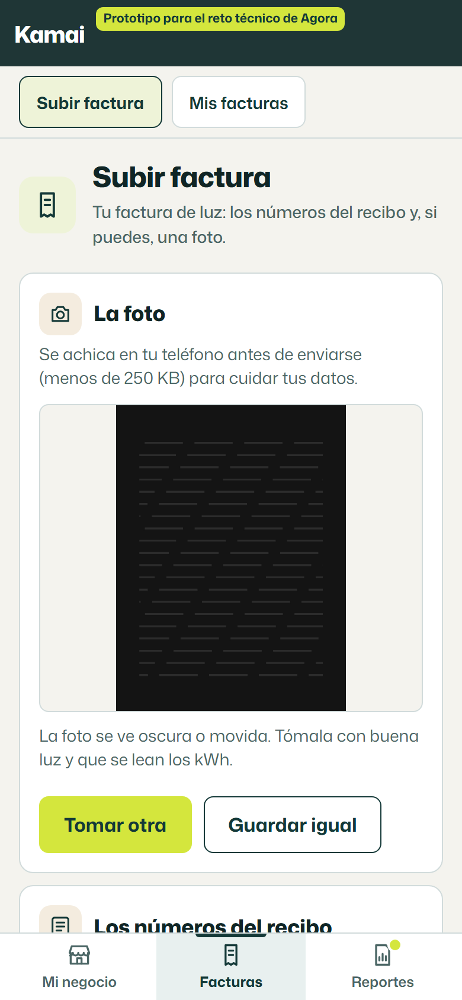<br><b>Subir factura</b><br>La foto se comprime y se revisa en el teléfono. Si sale oscura o movida, lo avisa y deja guardarla igual.</td>
    <td align="center" valign="top">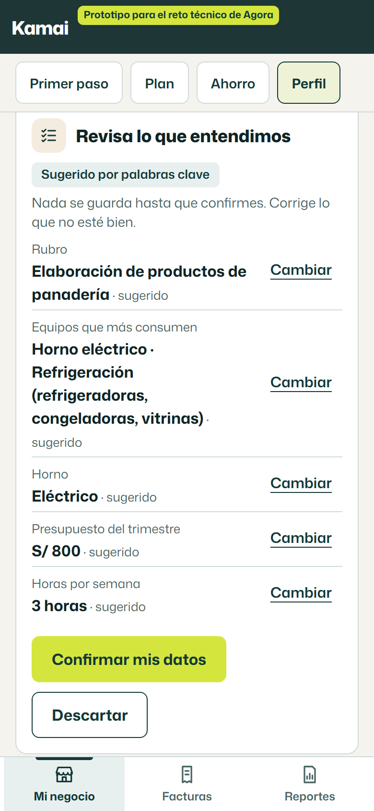<br><b>Perfil del negocio</b><br>Una descripción libre se convierte en rubro, equipos, horno, presupuesto y horas. Sin IA, sugiere por palabras clave. Nada se guarda sin confirmar.</td>
    <td align="center" valign="top"></td>
  </tr>
</table>

**En escritorio**, la misma app tiene una barra lateral con las tres secciones (Mi negocio, Facturas y Reportes). En el celular son tres botones abajo, y las páginas de la sección abierta aparecen arriba.

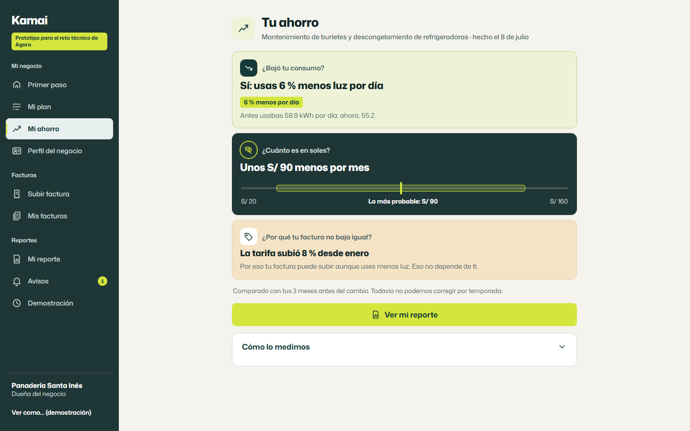

**El informe para aliados** muestra solo agregados y explica por qué oculta cada celda.

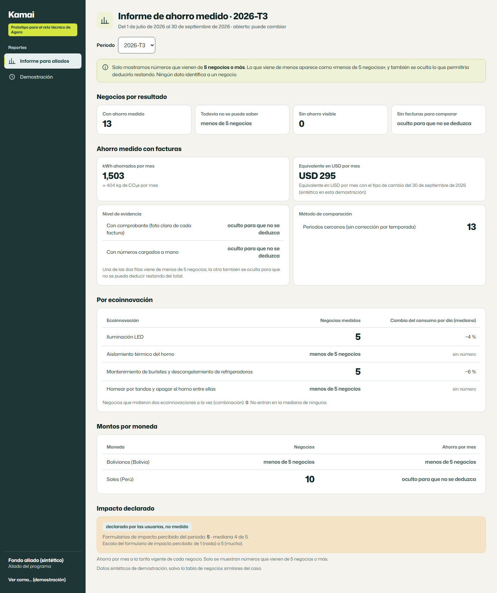

**El panel de demostración** permite elegir con quién se entra, simular el paso del tiempo, hacer fallar los servicios y ver los correos.

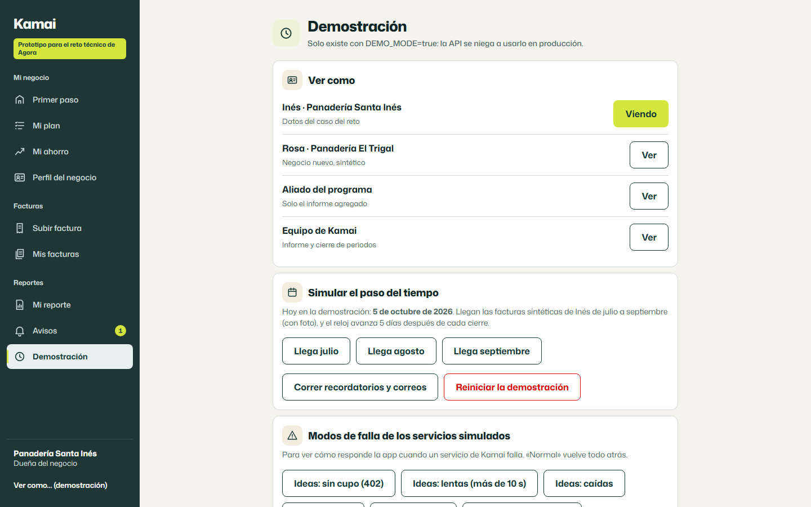

## Cómo funciona por dentro

### La recomendación

1. **Filtros duros**, con el motivo de cada exclusión guardado: objetivo, rubro (CIIU), equipos que el negocio tiene, presupuesto, horas por semana, complejidad admitida por su nivel de diagnóstico y planes existentes.
2. **Puntaje** = P(completar) × efecto esperado × penalizaciones.
   - P(completar) se contrae hacia el 30 % general con peso 5.
   - El efecto se contrae hacia 0 con peso 3: sin evidencia, no se promete ahorro.
   - La inversión que puede pasar el presupuesto pesa ×0,8. Un efecto que no se vería en *su* factura (más chico que lo que varía su consumo) pesa ×0,5.

Con los datos del caso queda así:

| Ecoinnovación | Eligieron / completaron / midieron | Cambio mediano | Puntaje | Por qué |
|---|---|---:|---:|---|
| **Burletes y descongelamiento de refrigeradoras** | 9 / 7 / 4 | −6 % | **2,08** | La más probable de terminar y su efecto se vería en la factura. |
| Hornear por tandas | 6 / 3 / 2 | −11 % | 1,80 | Buen efecto, pero la mitad no la terminó. |
| Iluminación LED | 11 / 9 / 5 | −4 % | 0,66 | Un 4 % queda dentro de lo que varía su consumo, y la inversión puede pasar su presupuesto. |
| Aislamiento térmico del horno | 2 / 1 / 1 | −18 % | excluida | Inversión y complejidad altas para su nivel, y ya tiene ese plan. |
| Calentador solar de agua | 1 / 0 / 0 | — | excluida | Inversión y complejidad altas, y no tiene termo eléctrico. |

Ordenar por la mayor mediana habría vuelto a elegir el aislamiento, con un solo caso: justo lo que la dejó trabada.

### La medición

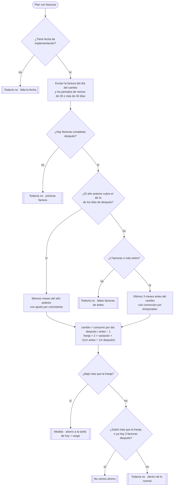

Con las facturas de Inés y las de la simulación:
- **Antes:** abril a junio, 58,9 kWh por día. Su consumo varía normalmente 2,57 %.
- **Solo agosto:** 57,1 kWh por día, −3,1 %. La franja con 3 facturas antes y 1 después es ±5,9 %, así que el resultado es **todavía no**.
- **Agosto y septiembre:** 55,2 kWh por día, −6,2 %. La franja es ±4,7 %, así que el resultado es **medido**: 3,66 kWh por día menos, unos 110 kWh por mes, **S/ 92,11 a la tarifa de hoy**, que se muestran como «unos S/ 90, entre S/ 20 y S/ 160».
- **Aparte:** la tarifa subió 7,7 % desde enero, y eso no depende de ella.

En una panadería, la temporada alta es la campaña de fin de año. Si se compara contra meses cercanos y el periodo cae en noviembre o diciembre, el resultado es «todavía no» y explica por qué.

### Cuánta IA hace falta

Con 29 elecciones y 12 resultados medidos no hay nada que entrenar. Cada técnica se usa donde corresponde a los datos que hay:

| Técnica | Para qué sí | Para qué no |
|---|---|---|
| Reglas explícitas | Filtros de elegibilidad y todos los textos que ve la usuaria | — |
| Estadística simple | Promedios contraídos para la recomendación; franja de ruido para decidir «medido» o «todavía no» | Pruebas de significancia con 2 a 6 facturas |
| Modelo de lenguaje | **Perfil asistido**: interpretar la descripción libre y elegir de listas cerradas, con montos verificados contra el texto | Elegir la recomendación, calcular el ahorro o leer fotos de facturas sin poder verificarlo |
| Modelo que aprende a ordenar | Nada, por ahora | No hay datos para entrenarlo ni evaluarlo; se guardan los registros para el futuro |

La IA interpreta, el código calcula y la usuaria confirma. El perfil asistido usa el SDK oficial de OpenAI con URL base configurable y **viene apagado**: sin clave, sugiere por palabras clave. La tabla completa está en [design.md › Cuánta IA hace falta](openspec/changes/primer-paso-ahorro-medido/design.md#cuánta-ia-hace-falta).

### Qué pasa cuando algo falla

| Falla | Qué ve la usuaria | Qué hace el sistema |
|---|---|---|
| La IA del perfil no responde o tarda más de 10 s | Sugerencias por palabras clave, en el mismo formulario | Usa la alternativa y registra el origen |
| Las ideas por paso se quedan sin cupo (402) o caen | «Se terminó el cupo gratis de ideas de este mes. Tus pasos siguen aquí.» | No reintenta solo ni cobra; los pasos del catálogo siempre están |
| El correo falla | Nada distinto: el aviso está en la app | Bandeja de salida con reintentos (1 min, 5 min, 30 min, 2 h, 12 h) y una clave por persona, plantilla y referencia |
| El correo rebota | «No pudimos escribirte a tu correo. Revisa que esté bien escrito.» | Suprime la dirección y cancela lo pendiente |
| La foto sale oscura, movida o chica | Un consejo para tomarla de nuevo, y «Guardar igual» | Guarda la factura con evidencia «foto para repetir» |
| Se corta la conexión | «Guardamos tu factura en el teléfono» | Borrador en IndexedDB, que se envía al volver la conexión |
| La base de datos no responde | «No pudimos guardar ni leer tus datos ahora.» | 503 con formato uniforme; el formulario conserva lo escrito |
| Edita o borra una factura | Si cambia una cifra que ya vio: «Recalculamos tu ahorro porque corregiste tu factura de septiembre: antes unos S/ 90, ahora unos S/ 75.» | Recalcula desde cero con versión y huella; guarda el historial de la factura |
| Cae el tipo de cambio | (Aliados) Montos en moneda local, con la nota «Equivalente en USD no disponible en este momento» | No bloquea el informe |

## Instalación y uso

### Requisitos

- **Node.js 22.22 o más** (probado en 22 y 24) y npm.
- Nada más: **no hace falta instalar MongoDB ni Docker**. La primera vez, `mongodb-memory-server` descarga el binario de MongoDB a una caché local.

### Correrlo

```bash
git clone https://github.com/ricardobing/ahorro-energetico-medido.git
cd ahorro-energetico-medido
npm install
npm run dev
```

`npm run dev` levanta tres procesos:

| Proceso | Dirección | Qué es |
|---|---|---|
| Web | **http://localhost:5180** | La app (React + Vite). Ábrela en el navegador; en el modo celular de las herramientas de desarrollo se ve como en el teléfono |
| API | http://localhost:4100 | Express 5 + MongoDB embebido en modo réplica (los datos quedan en `./.data`) |
| Simulaciones | http://localhost:4110 | Los servicios existentes de Kamai (correo, ideas con IA, tipo de cambio), con modos de falla |

La primera vez se cargan solos los datos del caso: Inés con sus seis facturas y su plan trabado, 22 panaderías sintéticas, un negocio nuevo y el catálogo.

### Quién entra

En modo demostración no hay inicio de sesión. Se elige con quién entrar desde **Reportes → Demostración → Ver como**, o con la dirección:

| Usuario | Dirección | Qué ve |
|---|---|---|
| Inés, Panadería Santa Inés (datos del caso) | `http://localhost:5180/?verComo=ines` | Su primer paso, plan, facturas y ahorro |
| Rosa, Panadería El Trigal (negocio nuevo, sintético) | `http://localhost:5180/?verComo=nuevo` | Una recomendación sin facturas y el perfil asistido |
| Aliado del programa | `http://localhost:5180/?verComo=aliado` | Solo el informe agregado |
| Equipo de Kamai | `http://localhost:5180/?verComo=equipo` | El informe, con el botón para cerrar el periodo |

### Panel de demostración

En **Reportes → Demostración**:
- **Simular el paso del tiempo:** llegan las facturas de julio, agosto y septiembre de Inés, con foto, y el reloj de la demostración avanza.
- **Modos de falla:** ideas sin cupo, lentas o caídas; correo caído o que rebota; tipo de cambio caído. «Normal» vuelve todo atrás.
- **Correr recordatorios y correos**, y ver la bandeja de correos enviados.
- **Reiniciar la demostración:** vuelve todo al estado inicial del caso.

### Configuración (opcional)

`npm run dev` lee `.env.example` y después `.env`, si existe. Para cambiar algo, copia `.env.example` a `.env`:

| Variable | Para qué |
|---|---|
| `DEMO_MODE` | Habilita «Ver como», el reloj de la demostración y el panel. **La API se niega a arrancar con `DEMO_MODE=true` y `NODE_ENV=production`.** |
| `MONGODB_URI` | Usa un MongoDB propio (con conjunto de réplicas) en lugar del embebido |
| `AI_PROFILE_ASSIST_ENABLED`, `AI_API_KEY`, `AI_BASE_URL`, `AI_MODEL_TEXT` | Enciende el perfil asistido con IA. Sin clave queda apagado y sugiere por palabras clave. En desarrollo se probó con OpenRouter y un modelo económico, siempre con datos ficticios |
| `MESSAGING_SERVICE_URL`, `SUBTASKS_SERVICE_URL`, `CURRENCY_SERVICE_URL` | Dónde están los servicios (por defecto, las simulaciones) |

### Comandos

| Comando | Qué hace |
|---|---|
| `npm run dev` | Levanta web, API y simulaciones |
| `npm test` | Tests unitarios, de propiedades, de integración y de componentes |
| `npm run test:coverage` | Lo mismo con cobertura (el dominio exige 95 % o más) |
| `npm run test:e2e` | Recorridos en celular y escritorio con Playwright (la primera vez: `npx playwright install chromium`) |
| `npm run trace` | Verifica que cada escenario de la spec tenga su test y regenera [docs/trazabilidad.md](docs/trazabilidad.md) |
| `npm run typecheck` · `npm run lint` · `npm run format:check` | Tipos estrictos, lint y formato |
| `npm run build` · `npm run test:bundle` | Versión de producción de la web y control de su peso |
| `npm run ci` | Todo lo anterior, en el orden de la CI |
| `npm run eval:profile` | Eval del perfil asistido con 40 descripciones (necesita `AI_API_KEY`; fuera de la CI) |
| `npm run capturas` | Regenera las capturas de este README (con `npm run dev` corriendo); `python scripts/componer-readme.py` arma la portada y el GIF |

## Guion de prueba en 8 pasos

Unos diez minutos, en el navegador (mejor en vista de celular):

1. `npm install && npm run dev` y abre **http://localhost:5180**. Entras como Inés.
2. **Tu primer paso:** mira la recomendación, los tres motivos y «Ver con qué datos lo elegimos». Arriba está el aviso del plan trabado hace 89 días. Toca **«Empezar este paso»**.
3. **Mi plan:** toca **«Terminé»**, elige el **8 de julio de 2026** y **«Guardar»**. Lee qué factura no cuenta y cuándo se va a ver el resultado.
4. **Reportes → Demostración → «Llega agosto».** En **Mi ahorro** aparece «Todavía no podemos saberlo»: parece que bajó, pero está dentro de lo normal.
5. **«Llega septiembre».** En **Mi ahorro**: 6 % menos luz por día, unos S/ 90 al mes (entre S/ 20 y S/ 160), y la tarifa aparte. Abre **«Cómo lo medimos»**.
6. **Facturas → Mis facturas → «Corregir»** la de septiembre: pon **1641** kWh y guarda. En **Mi ahorro** aparece «Recalculamos tu ahorro porque corregiste tu factura de septiembre: antes unos S/ 90, ahora unos S/ 75».
7. **Ver como Rosa** (negocio nuevo). En **Perfil**, escribe cómo es su negocio y toca **«Sugerir mis datos»**. La primera vez aparece el aviso de privacidad. Sin clave de IA, las sugerencias son por palabras clave. Al confirmarlas, su primer paso se recalcula con esos datos.
8. **Ver como Aliado → Informe para aliados (2026-T3):** celdas con «menos de 5 negocios», lo declarado aparte y nada que identifique a un negocio. Con **«Tipo de cambio: caído»** en Demostración, el USD queda marcado como no disponible.

Para volver al principio: **Demostración → «Reiniciar la demostración»**.

## Arquitectura y tecnologías

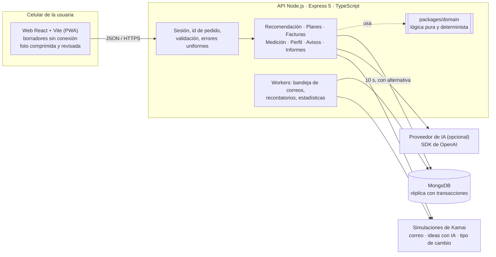

- **Todo lo que decide está en `packages/domain`:** TypeScript puro, sin dependencias, determinista. La API y la web solo lo usan, así que se puede llevar tal cual a otra API.
- **Facturas en una transacción:** el chequeo de superposición, la escritura y su versión van juntos. Dos envíos simultáneos del mismo periodo (reintentos con mala conexión) no pueden guardar dos facturas.
- **Mediciones versionadas:** cada resultado guarda la huella SHA-256 de sus datos. Con los mismos datos no se crea una versión nueva, y cualquier cifra mostrada se puede reproducir.
- **Sesión con adaptador:** en Kamai, el token que ya existe; en local, «Ver como». Cada negocio ve solo lo suyo, y otro negocio recibe 404.

| Parte | Tecnologías |
|---|---|
| Dominio | TypeScript estricto, sin dependencias de ejecución |
| API | Node.js 22+, Express 5, Mongoose 9, zod, pino (registros sin datos personales), helmet, multer, SDK de OpenAI |
| Web | React 19, Vite 8, React Router, TanStack Query, Tailwind CSS 4, vite-plugin-pwa, IndexedDB, gráficos e íconos en SVG propio, Mona Sans |
| Pruebas | Vitest, fast-check, supertest, mongodb-memory-server, React Testing Library, Playwright, axe-core |
| CI | GitHub Actions en Node 22 y 24 |

### Estructura

```text
.
├── openspec/changes/primer-paso-ahorro-medido/   La especificación: propuesta, diseño, tareas y requisitos
├── packages/
│   ├── domain/        Recomendación, medición, privacidad, perfil asistido, fechas y dinero (lógica pura)
│   └── fixtures/      Datos del caso y datos sintéticos rotulados
├── apps/
│   ├── api/           API Express 5 + MongoDB, workers, carga inicial y eval del perfil asistido
│   ├── mocks/         Simulaciones de correo, ideas con IA y tipo de cambio, con modos de falla
│   └── web/           App React para celular y escritorio
├── e2e/               Recorridos de punta a punta con Playwright y control de accesibilidad
├── scripts/           Trazabilidad escenario → test y capturas del README
└── docs/              Trazabilidad e imágenes
```

### En producción (propuesta)

Donde ya corre Kamai: la API y los workers en Cloud Run, MongoDB Atlas, las fotos en Cloud Storage, los recordatorios y estadísticas con Cloud Scheduler, la web en Firebase Hosting y la sesión con el login de Firebase que ya existe. El perfil asistido se activa recién después de la evaluación de impacto que pide la política de IA de Agora.

## Cómo se prueba

| Suite | Tests | Qué cubre |
|---|---:|---|
| Dominio | 129 | Fechas, dinero, medición (incluidas pruebas de propiedades con 1.000 casos: el orden de las facturas no cambia el resultado, ningún día se cuenta dos veces, la franja nunca es negativa), recomendación, privacidad y perfil. Cobertura de más del 98 % |
| API | 97 | Contra MongoDB real (en memoria, modo réplica): contratos, errores, aislamiento por negocio, transacciones, recálculo, correos con reintentos y rebotes, informe para aliados, adaptadores HTTP contra las simulaciones |
| Web | 33 | Componentes y pantallas: los tres estados del ahorro, errores del servidor, borrador sin conexión, perfil asistido, informe, navegación y contraste AA de cada par de colores |
| Simulaciones y datos | 15 | Contratos de los servicios simulados, datos del caso y trazabilidad |
| **e2e (Playwright)** | **10** | Recorrido completo en celular, pantalla de 360 px, controles de 44 px o más, control de accesibilidad con axe en 8 pantallas, foto de 4 MB que viaja en menos de 250 KB, corte de conexión, escritorio e informe para aliados |

- **Cada escenario de la spec tiene su test.** `npm run trace` lee los 122 escenarios de `spec.md`, los busca en los nombres de los tests y falla si alguno no tiene: [docs/trazabilidad.md](docs/trazabilidad.md).
- **Los números de los escenarios** (2,08 · 58,90 · ±5,94 % · S/ 92,11…) se calcularon con un script antes de escribirlos, para que la spec y los tests digan lo mismo.

## La especificación (OpenSpec)

La especificación es el entregable principal, y se puede construir y probar tal cual: esta app se hizo a partir de ella.

| Archivo | Qué tiene |
|---|---|
| [proposal.md](openspec/changes/primer-paso-ahorro-medido/proposal.md) | El problema, la meta con sus indicadores, el alcance, **dónde se profundizó y por qué**, y lo que queda fuera |
| [design.md](openspec/changes/primer-paso-ahorro-medido/design.md) | 24 decisiones con sus alternativas descartadas; cuánta IA hace falta; 3 diagramas; fallas; modelo de datos; contratos de la API; parámetros; dirección visual; evolución |
| [specs/…/spec.md](openspec/changes/primer-paso-ahorro-medido/specs/primer-paso-ahorro-medido/spec.md) | 67 requisitos con 122 escenarios WHEN / THEN |
| [tasks.md](openspec/changes/primer-paso-ahorro-medido/tasks.md) | 90 tareas en orden, cada una con su verificación |

Validación: `npx @fission-ai/openspec@1.14.1 validate primer-paso-ahorro-medido --strict`.

## Qué es real, simulado y sintético

| Origen | Qué |
|---|---|
| **Del caso del reto** | Las seis facturas de Inés, su plan trabado (`plan_552`), la ecoinnovación del anexo (`eco_118`), los contratos de la API existente y la tabla de 23 panaderías |
| **Simulado** | Los servicios existentes de Kamai (correo, ideas con IA, tipo de cambio). Responden con los contratos del anexo y se pueden hacer fallar |
| **Sintético y rotulado** | Las facturas de julio a septiembre de la simulación, las otras 22 panaderías (reproducen la tabla del caso, verificado por un test), el negocio nuevo, el catálogo ampliado, los rangos de inversión por país, los tipos de cambio y el factor de CO₂e |

## Límites y próximos pasos

- **Temporada en negocios nuevos.** Sin un año de facturas se compara contra los meses cercanos y se rotula así. El paso siguiente es un grupo de comparación: negocios parecidos que no cambiaron nada en los mismos meses.
- **Lectura de la foto de factura con IA.** Está diseñada como evolución, pero no se implementó porque sin facturas reales no se puede verificar. Se haría con un eval sobre facturas reales y con la evaluación de impacto aprobada.
- **Parámetros por calibrar con Agora:** rangos de inversión por país, factor de CO₂e por país y los pesos de la contracción.
- **Un modelo que ordena**, cuando haya resultados suficientes. Se guardan las recomendaciones con sus entradas y los eventos del embudo para entrenarlo y compararlo contra las reglas.
- **Fuera de este prototipo:** integración real con los servicios de Kamai, WhatsApp, autenticación propia y despliegue.

## Cómo se construyó

Con desarrollo guiado por la especificación, en etapas y con revisión entre cada una:

1. **Análisis del caso:** las trampas de los datos, recalculadas con un script.
2. **Especificación OpenSpec:** requisitos, escenarios con números exactos, decisiones con alternativas y diseño.
3. **Tests en rojo:** un test por escenario, antes de cualquier lógica.
4. **Implementación:** con agentes de IA como equipo de ejecución, hasta que todo quedó en verde y revisado en el navegador.

La IA escribió buena parte del código. Las decisiones, la especificación y las pruebas que deciden qué entra son mías.

---

**Ricardo Brossard** · [ricardobrossard.com](https://ricardobrossard.com)
