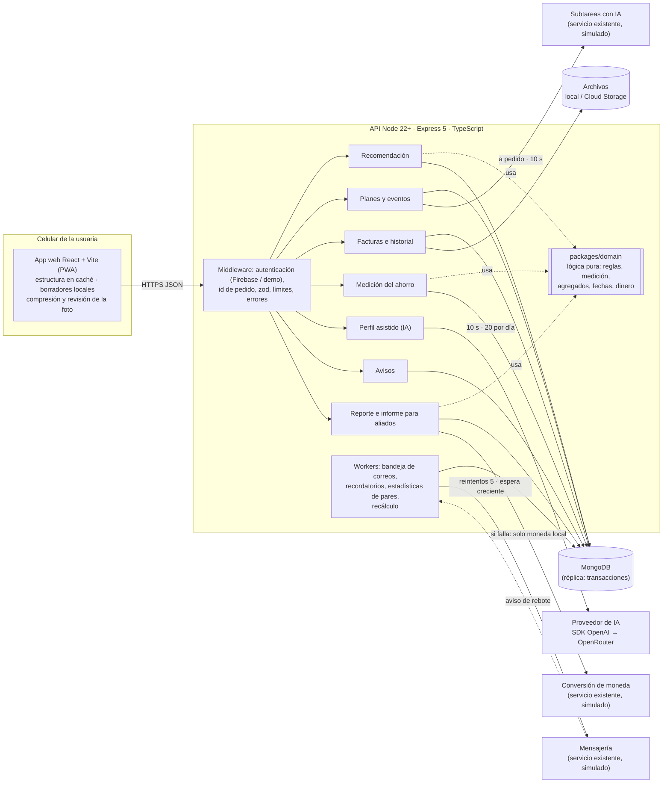
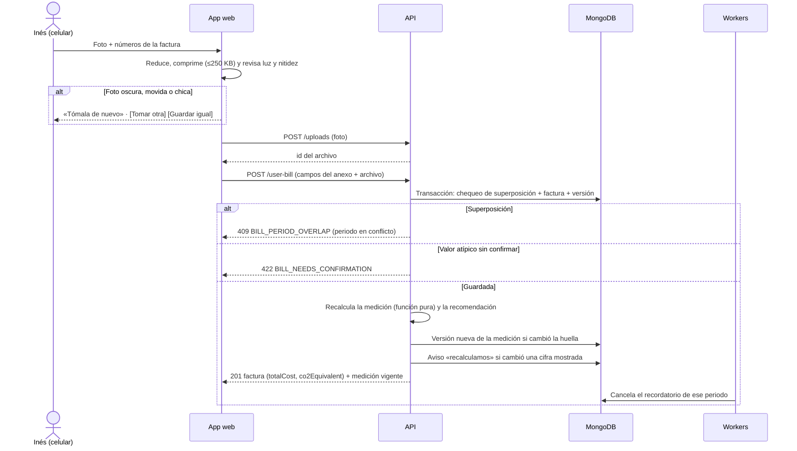

# Diseño técnico: Primer paso con ahorro medido

> Los requisitos están en `specs/primer-paso-ahorro-medido/spec.md` y el porqué en `proposal.md`. Este documento explica **cómo** se construye: decisiones con las alternativas descartadas, arquitectura, datos, contratos, parámetros, integraciones y sus fallas, tecnologías y plan de migración.

## Context

- **Lo que existe en Kamai** (según el reto):
  - frontend React + Vite, API Node.js y MongoDB;
  - el plan de acción guarda solo su estado y la fecha del último cambio;
  - las facturas no tienen moneda ni están ligadas a una ecoinnovación;
  - el catálogo no tiene montos;
  - el perfil tiene un CIIU opcional y la cantidad de empleados en texto libre, y no guarda equipos;
  - cuatro superficies recomiendan con criterios distintos;
  - el servicio de mensajería deduplica por persona y plantilla;
  - las subtareas con IA consumen un cupo y responden 402 sin créditos.
- **Restricciones que moldean el diseño:**
  - pocos casos por ecoinnovación (de 1 a 11);
  - seis meses de facturas para el caso de referencia;
  - tarifas que cambian casi todos los meses;
  - uso desde el celular con datos limitados;
  - políticas de Agora: POL-IT-003 de IA (explicabilidad, supervisión humana, evaluación de impacto o DPIA) y POL-IT-001 de datos (agregados para financiadores, minimización).
- **Este repositorio** es un prototipo ejecutable del módulo. Corre solo en local, con los servicios existentes simulados con sus contratos. La lógica de negocio vive en un paquete puro, sin dependencias, para que pueda llevarse tal cual a la API real de Kamai.

## Goals / Non-Goals

**Goals:**
- Recomendación y medición **deterministas y auditables**: los mismos datos dan el mismo resultado, cada resultado tiene versión y huella de los datos.
- Un módulo que entra en la API de Kamai (Express + MongoDB) **sin modificar código existente**: las superficies actuales solo pasan a leer la recomendación.
- Lo esencial funciona **sin IA, sin correo y con mala conexión**.
- Un comando para levantar todo (`npm run dev`) y uno para probar todo (`npm test`).
- Presupuesto de rendimiento para celular: 120 KB o menos de JavaScript inicial y fotos de 250 KB o menos.

**Non-Goals:**
- Autenticación propia: se usa la de Kamai, con un adaptador simulado en local.
- Integraciones reales, despliegue a producción y aprendizaje automático.
- Internacionalización más allá del español. Los textos quedan centralizados para traducirlos después.

## Decisions

Cada decisión tiene su porqué y las alternativas descartadas. Los parámetros numéricos están en la sección **Parámetros**.

### D1. Una sola capacidad en OpenSpec
**Decisión:** una capacidad, `primer-paso-ahorro-medido`, con todos los requisitos.
**Por qué:** el reto la nombra así y es **un solo recorrido** de la usuaria (recomendar, completar, medir y mostrar). Partirla obligaría a cruzar referencias en cada escenario.
**Descartado:** separarla en `recomendacion`, `medicion` y `datos-agregados`. Sería más modular, pero rompe la trazabilidad del recorrido; puede dividirse al archivar el cambio si el equipo prefiere especificaciones por dominio.

### D2. Recomendación con reglas y un puntaje transparente
**Decisión:** primero filtros duros por restricciones; después un puntaje = P(completar) × efecto esperado, ambos **contraídos** hacia una referencia conservadora, con penalizaciones (presupuesto parcial y efecto que no se vería). El resultado se guarda con sus motivos.
**Por qué:** con 29 elecciones y 12 resultados medidos no hay con qué entrenar nada. Las reglas se explican a la usuaria y a los aliados, y la política de IA de Agora pide explicabilidad.
**Descartado:**
- *Ordenar por la mayor mediana:* el caso único del aislamiento (−18 %, n=1) gana, que es lo que dejó a Inés siete semanas trabada.
- *Ordenar por cantidad de datos:* gana el LED, cuyo −4 % no se vería en su factura.
- *Un modelo que aprende a ordenar:* no hay etiquetas suficientes.
- *Que elija un modelo de lenguaje:* no es reproducible ni auditable, cuesta por consulta y puede inventar números.

### D3. Contracción conservadora
**Decisión:** la tasa de completado se contrae hacia el 30 % general con peso 5, y el efecto hacia 0 con peso 3 («sin evidencia, no prometemos ahorro»).
**Por qué:** en la prueba de sensibilidad del análisis inicial, con supuestos débiles gana el aislamiento; con supuestos conservadores, burletes queda primero en todas las variantes. Hay un escenario en la spec que fija esto.
**Descartado:** usar las medianas tal cual, o un Beta-binomial completo (agrega complejidad sin cambiar el orden con estos datos).

### D4. Presupuesto y horas con rangos de referencia por país
**Decisión:** BAJA, MEDIA y ALTA se traducen a rangos configurables por país (para Perú: inversión de hasta S/ 500, de 500 a 2.000 y más de 2.000; tiempo de hasta 2 h, de 2 a 4 h y más de 4 h por semana). Un nivel es compatible, compatible con penalización o excluido según dónde caen sus límites.
**Por qué:** el catálogo no tiene montos y no se inventan. Los rangos son explícitos, están rotulados como sintéticos y Agora los calibra sin tocar código.
**Descartado:** pedir montos por ecoinnovación (no existen), inventarlos, o ignorar el presupuesto.

### D5. Medir en kWh por día y valorizar a la tarifa vigente
**Decisión:** toda comparación se hace en kWh por día, ponderando por días. El ahorro en dinero = kWh ahorrados × tarifa del periodo posterior más reciente. El cambio de tarifa se informa aparte.
**Por qué:** elimina las dos trampas del caso (febrero con menos días y la tarifa que subió 7,7 %) y responde la pregunta de la usuaria: «cuánto menos pagas hoy por haber hecho el cambio».
**Descartado:** comparar soles (mezcla tarifa y consumo); normalizar a la tarifa de la línea de base (subestima el ahorro a precios de hoy).

### D6. Jerarquía de métodos de comparación
**Decisión:** (1) **interanual** cuando hay datos que cubren al menos el 80 % de los días del año anterior, con ajuste por la tendencia previa si hay pares; si no, (2) **periodos cercanos**, con las últimas 3 facturas completas antes del cambio, el rótulo «sin corrección por temporada» y un bloqueo de la temporada alta del rubro; (3) grupo de comparación, en la versión 2.
**Por qué:** el interanual corrige clima y calendario a la vez, y es el estándar de medición con facturas (IPMVP, opción C). Pero los negocios nuevos, que son los de la meta de 90 días, no tienen un año de historial. En Arequipa el clima casi no varía; la temporada la marca la campaña de fin de año.
**Descartado:** solo periodos cercanos (arrastra temporada); solo interanual (deja sin medición a los negocios nuevos); regresión con grados-día (6 a 12 puntos por negocio no alcanzan, y el clima de Arequipa no la justifica).

### D7. Banda de ruido con la variación propia
**Decisión:** banda = 2 × σ × √(1/n_antes + 1/n_después). σ es la variación relativa del consumo por día del negocio con 4 o más facturas válidas, o 3 % por defecto.
**Por qué:** cada negocio tiene su propio vaivén (Inés: 2,57 %). La fórmula da el cambio mínimo que se puede distinguir y responde «¿cuándo le decimos todavía no?» con un criterio explicable.
**Descartado:** una prueba estadística formal (con tan pocos puntos da una falsa sensación de rigor); un umbral fijo de 5 % (ignora que hay negocios más estables y otros más variables).

### D8. Excluir la factura que contiene el día del cambio
**Decisión:** esa factura no cuenta ni como «antes» ni como «después».
**Por qué:** prorratear supone un consumo parejo dentro del periodo, que no se puede verificar. Excluirla es simple, honesto y fácil de explicar («incluye el día del cambio, no cuenta»).
**Descartado:** prorratear por días.

### D9. Recálculo determinista con versiones y huella
**Decisión:** la medición es una función pura de (facturas vigentes, historial estimado, `implementedAt`, versión del método). Se recalcula entera ante cada cambio, y la huella (SHA-256 del JSON canónico de las entradas) decide si hay versión nueva.
**Por qué:** sin acumuladores no hay doble conteo, ediciones y borrados son triviales y cada cifra mostrada es reproducible para auditoría.
**Descartado:** acumular ahorros incrementalmente (frágil ante ediciones y borrados, y propenso a contar dos veces).

### D10. Transacciones de MongoDB para escribir facturas
**Decisión:** el chequeo de superposición, la escritura de la factura y su versión van en una transacción. Requiere un conjunto de réplicas: Atlas lo tiene, y en local se usa `mongodb-memory-server` en modo réplica.
**Por qué:** dos envíos simultáneos (reintentos con mala conexión) podrían pasar ambos el chequeo de superposición.
**Descartado:** bloqueo optimista con un contador en el negocio (funciona, pero es más código propio para el mismo resultado).

### D11. Bandeja de salida de correos en MongoDB
**Decisión:** la colección `emailOutbox` tiene una clave única `(persona, plantilla, referencia)` y estados pendiente, enviando, enviado, falló, rebotó y suprimido. Un worker envía con reintentos de espera creciente.
**Por qué:** el registro actual por persona y plantilla bloquearía el segundo recordatorio mensual. Marcar como enviado antes de enviar pierde correos y marcarlo después los duplica; la bandeja resuelve las dos cosas.
**Descartado:** envío directo con el registro actual; una cola externa (Pub/Sub), que es infraestructura nueva para un volumen chico.

### D12. Avisos dentro de la app como canal principal
**Decisión:** todo aviso queda en `notifications` y se ve en la app; el correo es una copia.
**Por qué:** el correo puede fallar o rebotar, y la usuaria vive en la app desde el celular.

### D13. IA: perfil asistido con listas cerradas
**Decisión:**
- SDK oficial de OpenAI con URL base configurable: OpenRouter en desarrollo, OpenAI directo como referencia de producción.
- Salida estructurada con esquema JSON estricto. El modelo **elige** de listas cerradas (CIIU, equipos, tipo de horno) y extrae montos y horas que **se verifican contra el texto**.
- Alternativa por palabras clave y bandera de activación.
- Modelo de desarrollo: `deepseek/deepseek-v4.1-flash`, por costo y solo con datos ficticios. En producción, un modelo de OpenAI elegido con un eval y la DPIA.

**Por qué:**
- Kamai no guarda los equipos ni un rubro fiable, y la recomendación los necesita.
- Una descripción libre es más natural para una usuaria no técnica que un formulario largo.
- Es probable en local y demostrable.
- La IA interpreta y el código decide.

**Descartado:**
- *Leer fotos de factura con IA:* diseñado (ver Evolución), pero no se implementa en esta instancia porque no se puede verificar sin facturas reales.
- *Solo palabras clave:* es la alternativa, pero entiende peor las descripciones reales.
- *SDK de Anthropic:* decisión del autor (costo y libertad de proveedor).

### D14. Privacidad de los datos de otros negocios
**Decisión:** los agregados se calculan solo en el servidor; un número se muestra con 5 negocios o más; con 3 o 4, una frase cualitativa; se aplica supresión complementaria; las comparaciones entre países van solo en porcentajes; nunca hay ubicaciones más finas que el país.
**Por qué:** hay 23 panaderías en dos países, con 2 o 3 por ciudad, así que el riesgo de reidentificar es real. El −18 % del aislamiento es el dato de una panadería identificable.
**Descartado:** umbral de 3 (muy reidentificable con estos números); de 10 (hoy no mostraría nada); privacidad diferencial (con n de 1 a 11, el ruido borra la señal).

### D15. Moneda por país, conversión solo en el informe
**Decisión:** cada factura toma la moneda del país del negocio. La conversión a USD se hace solo en el informe para aliados, con el tipo de cambio del periodo, y si el servicio falla se informan las monedas locales.
**Por qué:** las facturas no tienen moneda y mezclar PEN con BOB es un error silencioso.

### D16. Fotos comprimidas y revisadas en el teléfono
**Decisión:**
- La foto se reduce a 1.600 px de lado largo y se comprime a 250 KB o menos con `canvas`.
- En el mismo paso se revisa: tamaño (menos de 1.000 px), luz (luminancia media fuera de 50 a 225 sobre 255) y nitidez (varianza del laplaciano por debajo del umbral).
- Si no pasa la revisión, se sugiere volver a tomarla y siempre se puede guardar igual.

**Por qué:** ahorra datos móviles y resuelve «¿qué ve Inés si la foto no se puede leer?» sin IA ni servidor.
**Descartado:** revisar en el servidor (implica subir primero una foto pesada); OCR (no se puede verificar en esta instancia).

### D17. Frontend React + Vite como PWA, con los tokens de Kamai
**Decisión:**
- React 19 + Vite + TypeScript, con React Router y TanStack Query.
- Tailwind CSS v4 con las variables y los valores de Kamai medidos en el sitio (`--primary`, `--accent`…; ver Dirección visual).
- PWA con la estructura de la app en caché.
- Gráficos en SVG propio y Mona Sans servida desde el proyecto.

**Por qué:** es el stack del PDF. Los tokens con los nombres de Kamai hacen que los componentes encajen en su código. El SVG propio cuida el presupuesto de 120 KB. La fuente servida desde el proyecto funciona sin conexión y no depende de otro dominio.
**Descartado:** Next.js (el sitio público lo usa, pero el PDF dice que la app es Vite); una librería de gráficos (pesa más que toda la pantalla).

### D18. Express 5 con Mongoose y zod
**Decisión:** Express 5 (errores asíncronos nativos), esquemas de Mongoose para las colecciones y zod para validar las entradas.
**Por qué:** es lo más probable en un stack React + Node + Mongo como el de Kamai (S11), así que el módulo encaja sin cambiar de framework. zod da mensajes de error controlados y tipos compartidos con el frontend.
**Descartado:** Fastify (más rápido, pero obligaría a adaptar el módulo si Kamai usa Express); el driver nativo sin esquemas (más código de validación propio).

### D19. Fechas sin hora y dinero en céntimos
**Decisión:** las fechas de los periodos son cadenas `AAAA-MM-DD` con aritmética propia (días inclusivos, años bisiestos). El dinero va en enteros de céntimos y se redondea solo al mostrar.
**Por qué:** evita que el 28 de febrero se muestre como 27 en UTC−5, y que `1690 × 0.78` dé `1318.2000000000003`.

### D20. Autenticación con un adaptador
**Decisión:** en Kamai, un middleware que verifica el token de Firebase existente y resuelve el negocio. En local, el encabezado `X-Demo-User` (Inés, negocio nuevo, aliado o equipo), activo solo con `DEMO_MODE=true`. La API **se niega a arrancar** con `DEMO_MODE` en producción.
**Por qué:** el reto no pide autenticación, pero cada negocio tiene que ver solo lo suyo y eso tiene que poder probarse.

### D21. Estado `paused` en el plan
**Decisión:** se agrega `paused` a los estados del plan y se crea la colección de eventos `planEvents`. El cambio es compatible: las lecturas que no conocen `paused` lo pueden tratar como `delayed`.
**Por qué:** pausar el aislamiento no es abandonarlo, y `delayed` no expresa una decisión de la usuaria.
**Descartado:** reutilizar `delayed` o `to_define`.

### D22. Servicios simulados detrás de HTTP real
**Decisión:** un servidor de simulación aparte (puerto 4110) implementa los contratos del anexo: mensajería, subtareas con IA y conversión de moneda. Tiene modos de falla (error, demora, 402, rebote) que se cambian desde el panel de demostración y desde los tests.
**Por qué:** los adaptadores de la API hablan HTTP como en producción, y las fallas del punto 4 del reto se pueden mostrar en el video.
**Descartado:** dobles en memoria dentro de la API (no prueban timeouts ni errores de red).

### D23. Monorepo con workspaces de npm
**Decisión:** `apps/api`, `apps/web`, `apps/mocks` y `packages/domain`, con `e2e/` y `openspec/` en la raíz.
**Por qué:** la lógica de dominio se comparte entre la API (cálculo) y la web (formatos y textos), con un solo `npm install`.

### D24. Correr la app con npm, sin Docker
**Decisión:** un solo camino: `npm install` y `npm run dev`, con **Node 22 o más** (CI prueba en 22 y 24).
- Levanta MongoDB embebido (`mongodb-memory-server` en modo réplica, persistente en `./.data`), carga los datos del caso y arranca la API (puerto 4100), las simulaciones (4110) y la web (5180).
- Los puertos se eligieron para no chocar con otros proyectos locales (3000, 27017, 5432x). Con `MONGODB_URI` se puede usar un MongoDB propio.
- La vitrina para quien entra desde GitHub sin correr nada es el README: capturas y GIF del recorrido, el **badge de CI en verde** y los enlaces a la spec y al video.

**Por qué:** la mayoría de quienes evalúan lee el repositorio, la spec y el video, y no ejecuta nada. Quien sí quiere probarla necesita solo Node. Para nosotros es el camino más rápido (recarga en caliente, tests sin dependencias externas) y el que menos hay que mantener.
**Descartado:**
- *Docker Compose:* suma Dockerfiles, nginx, el inicio de la réplica de MongoDB y healthchecks, con fricción en Windows, para un beneficio que casi nadie usaría al evaluar.
- *Node 24 como mínimo:* deja afuera a quien tiene la versión 22, que sigue con soporte.
- *Un entorno en la nube (Codespaces):* posible más adelante; no hace falta para el reto.

## Arquitectura

### Qué corre dónde



### Qué pasa cuando algo falla

| Falla | Qué ve la usuaria | Qué hace el sistema |
|---|---|---|
| Proveedor de IA caído, lento (más de 10 s), sin clave o bandera apagada | Sugerencias por palabras clave en el mismo formulario | Usa la alternativa por palabras clave y registra el origen. No hay error visible. |
| Subtareas: 402, error o más de 10 s | «Tus pasos siguen aquí», con un mensaje según el caso | No reintenta solo ni cobra. Los pasos del catálogo siempre están. |
| Mensajería: 429, 5xx o sin respuesta | Nada distinto: el aviso está en la app | Reintenta hasta 5 veces (1 min, 5 min, 30 min, 2 h, 12 h) y después marca el envío como fallido. |
| Mensajería: 4xx | Nada distinto | Marca el envío como fallido, sin reintentos. |
| Rebote | «Revisa tu correo» en avisos | Suprime la dirección y cancela lo pendiente. |
| Conversión de moneda caída | (Aliados) solo monedas locales, con nota | No bloquea el informe. |
| Almacenamiento de fotos caído | «No pudimos guardar la foto, la guardamos en tu teléfono» | Guarda los números con «sin foto» y deja la foto pendiente en el teléfono para reintentar. |
| MongoDB caído | «No pudimos guardar, intenta en un rato» | Responde 503 `SERVICE_UNAVAILABLE`; la web conserva el borrador. |
| Sin conexión | «Guardamos tu factura en el teléfono» | El borrador queda en IndexedDB y el envío se reintenta al volver la conexión. |

### Subir una factura: secuencia



### Medición: cómo se elige el método y el resultado

```mermaid
flowchart TD
  S([Plan con facturas]) --> I{¿Tiene implementedAt?}
  I -- no --> N1[[INSUFFICIENT_DATA · NO_IMPLEMENTATION_DATE]]
  I -- sí --> X[Excluir la factura del día del cambio<br/>y los periodos de menos de 20 o más de 40 días]
  X --> P{¿Hay facturas completas después?}
  P -- no --> N2[[INSUFFICIENT_DATA · NO_AFTER_BILL]]
  P -- sí --> Y{¿El año anterior cubre al menos<br/>el 80 % de los días de cada periodo posterior?}
  Y -- sí --> YY[YEAR_OVER_YEAR<br/>ajuste por tendencia si hay al menos 2 pares previos]
  Y -- no --> B{¿Al menos 2 facturas completas antes?}
  B -- no --> N3[[INSUFFICIENT_DATA · NOT_ENOUGH_BASELINE]]
  B -- sí --> H{¿El periodo posterior cae en la temporada alta<br/>del rubro y la línea de base no?}
  H -- sí --> N4[[INSUFFICIENT_DATA · HIGH_SEASON]]
  H -- no --> RP[RECENT_PERIODS<br/>últimas 3 antes · «sin corrección por temporada»]
  YY & RP --> C[cambio = después / referencia − 1<br/>banda = 2σ√(1/n_ref + 1/n_después)]
  C --> M{¿Cambio ≤ −banda?}
  M -- sí --> R1[[MEASURED · ahorro a la tarifa vigente + rango]]
  M -- no --> U{¿Cambio ≥ +banda o<br/>3 o más facturas después?}
  U -- sí --> R2[[NO_SAVINGS_DETECTED]]
  U -- no --> R3[[INSUFFICIENT_DATA · WITHIN_NOISE · próxima factura]]
```

## Modelo de datos (MongoDB)

Los campos existentes del anexo no cambian. Lo nuevo es opcional o vive en colecciones nuevas.

| Colección | Campos principales | Índices |
|---|---|---|
| `businesses` (existente + nuevos) | `country`, `ciiu?`, `employeesText`, `description`, **`equipment[]`**, **`ovenType`** (`electric` · `gas` · `diesel` · `none` · `unknown`), **`constraints`** (`budgetQuarterCents`, `currency`, `hoursPerWeek`), `diagnostic` (`topic`, `level`, `sectionScores`), **`aiNoticeAcceptedAt?`** | `_id` |
| `ecoCatalog` (existente + nuevo) | campos del anexo + **`targetEquipment[]?`** | `id` único |
| `userEcoCards` (existente + nuevos) | campos del anexo + **`businessId`**, **`implementedAt?`** (`AAAA-MM-DD`), `createdAt`; `status` suma **`paused`** | `{businessId, status}` |
| `planEvents` | `planId`, `businessId`, `type` (`created` · `status_changed` · `paused` · `resumed` · `completed` · `reopened`), `from`, `to`, `at`, `data` | `{planId, at}` |
| `userBills` (existente + nuevos) | campos del anexo + **`businessId`**, **`serviceType`** (`electricity` · `water`), **`currency`**, **`evidence`** (`photo_ok` · `photo_retake` · `no_photo`), **`atypicalConfirmed`**, **`version`**, **`deletedAt?`**; `totalCost` y `co2Equivalent` calculados | `{businessId, serviceType, billingStartDate}` |
| `userBillVersions` | copia completa de cada versión anterior + `changedAt` | `{billId, version}` único |
| `consumptionHistory` | `businessId`, `serviceType`, `month` (`AAAA-MM`), `kwh`, `source: 'bill_chart'`, `estimated: true` | `{businessId, serviceType, month}` único |
| `recommendations` | `businessId`, `status` (`current` · `superseded`), `ecoId`, `ranked[]` (`ecoId`, `score`, `factors`, `reasons[]`), `excluded[]` (`ecoId`, `reasons[]`), `inputs` (instantánea + `peerStatsVersion`), `rulesetVersion`, `inputsHash`, `decision?`, `createdAt` | `{businessId, status}` |
| `peerStats` | `version`, `sector`, `ecoId`, `chose`, `completed`, `measuredCount`, `medianChangePct`, `source` (`case_table` · `computed`) | `{version, sector, ecoId}` |
| `savingsMeasurements` | `planId`, `businessId`, `version`, `current`, `inputsHash`, `methodVersion`, `status`, `reasons[]`, `method`, `labels[]`, `baseline`, `after`, `changePct`, `bandPct`, `sigmaPct`, `savings`, `tariff`, `excludedBills[]`, `nextBillEta`, `computedAt` | `{planId, current}`, `{planId, version}` único |
| `notifications` | `businessId`, `type`, `title`, `body`, `link`, `createdAt`, `readAt?` | `{businessId, createdAt}` |
| `emailOutbox` | `idempotencyKey` (persona · plantilla · referencia), `businessId`, `to`, `template`, `ref`, `status`, `attempts`, `nextAttemptAt`, `lastError?`, `acceptedAt?` | `idempotencyKey` único; `{status, nextAttemptAt}` |
| `emailSuppressions` | `email`, `reason: 'bounce'`, `at` | `email` único |
| `partnerReports` | `period` (`AAAA-Tn`), `status` (`open` · `closed`), `closedAt?`, `snapshot`, `adjustments[]` | `period` único |
| `funnelEvents` | `type`, `businessId` (identificador interno, sin datos personales), `ecoId?`, `at` | `{type, at}` |
| `aiUsage` | `businessId`, `day`, `count` | `{businessId, day}` único |

## Contratos de la API

Todas las rutas de negocio toman el negocio de la sesión y nunca del cuerpo del pedido. Los errores tienen siempre esta forma: `{ "error": { "code", "message", "details?" }, "requestId" }`.

| Método y ruta | Uso | Respuestas |
|---|---|---|
| `GET /first-step` | Recomendación vigente (la calcula si no existe) | 200 `{ recommendation, explanation, alternatives, stalledPlan? }` |
| `POST /first-step/decision` | `{ action: "accept" \| "choose", ecoId?, pausePlanId? }` | 201 plan creado · 409 si la ecoinnovación no es elegible |
| `GET /catalog` | Catálogo con `pinned` (la recomendación vigente) | 200 |
| `GET /welcome-email/preview` | Correo de bienvenida armado con la misma recomendación | 200 `{ subject, html }` |
| `GET /user-eco-card/:id` | Plan (contrato del anexo) + `stalled`, `implementedAt`, `events` | 200 · 404 |
| `PATCH /user-eco-card/:id` | `{ status?, implementedAt?, stepStatus? }` | 200 · 422 `IMPLEMENTED_AT_REQUIRED` / `IMPLEMENTED_AT_INVALID` |
| `POST /user-eco-card/:id/steps/:stepId/ideas` | Pide subtareas al servicio existente | 200 · 402 `AI_QUOTA_EXCEEDED` · 503 `AI_UNAVAILABLE` |
| `POST /uploads` | Foto de factura (multipart; JPEG, PNG o WebP; 5 MB o menos) | 201 `{ fileId }` · 413 · 415 |
| `GET /user-bill` · `POST /user-bill` · `PATCH /user-bill/:id` · `DELETE /user-bill/:id` | Facturas (campos del anexo + `serviceType`, `confirmAtypical`) | 201/200 + `measurement?` · 400 · 404 · 409 `BILL_PERIOD_OVERLAP` · 422 `BILL_NEEDS_CONFIRMATION` · 503 |
| `PUT /consumption-history` | Historial del recibo: `{ serviceType, months: [{ month, kwh }] }` | 200 |
| `GET /user-eco-card/:id/savings` | **Medición vigente** (la pieza profunda) | 200 `{ status, reasons, method, labels, baseline, after, changePct, bandPct, savings, tariff, excludedBills, nextBillEta, display, version, inputsHash }` |
| `GET /savings/report` | Reporte imprimible de la usuaria | 200 |
| `POST /profile/assist` | `{ description }` → sugerencias del perfil | 200 `{ suggestions, source: "ai" \| "keywords", notice? }` · 429 → `source: "keywords"` |
| `PATCH /profile` | Confirma perfil, equipos, horno y restricciones | 200 (recalcula la recomendación) |
| `GET /notifications` · `POST /notifications/:id/read` | Avisos | 200 |
| `GET /partners/report?period=` · `POST /partners/report/:period/close` | Informe agregado (rol aliado o equipo) | 200 · 403 |
| `POST /webhooks/messaging/bounce` | Aviso de rebote del servicio de mensajería (contrato a confirmar) | 204 |

La medición devuelve `display` con los textos ya armados para la usuaria (frase principal, rango, línea del método, nota de tarifa), para que web, correo y reporte digan exactamente lo mismo.

## Parámetros (configurables, versión de reglas 1.0.0 y de método 1.0.0)

| Parámetro | Valor | Dónde se usa |
|---|---|---|
| Referencia de completado / peso | 30 % / 5 | Recomendación |
| Referencia de efecto / peso | 0 % / 3 | Recomendación |
| Penalización por presupuesto parcial | ×0,8 | Recomendación |
| Penalización por efecto no detectable | ×0,5 (si la mediana es menor que la banda con 3 antes y 2 después) | Recomendación |
| Complejidad máxima por nivel | Inicial: BAJA · Crecimiento: MEDIA · Consolidación o más: ALTA | Recomendación |
| Rangos de inversión, Perú (sintéticos) | BAJA ≤ S/ 500 · MEDIA S/ 500-2.000 · ALTA > S/ 2.000 | Recomendación |
| Rangos de tiempo | BAJA ≤ 2 h · MEDIA 2-4 h · ALTA > 4 h por semana | Recomendación |
| Plan estancado | 28 días sin cambios en los pasos | Plan |
| Antigüedad máxima de `implementedAt` | 365 días | Plan |
| Valores atípicos | consumo por día < 0,3× o > 3× la mediana | Facturas |
| Periodo válido para medir / máximo para guardar | 20 a 40 días / 92 días | Medición / Facturas |
| Tarifa aceptada | Perú: 0,20 a 3,00 S/ por kWh · Bolivia: 0,30 a 5,00 Bs por kWh | Facturas |
| Cobertura mínima interanual | 80 % de los días | Medición |
| σ por defecto / mínimo de facturas para σ propia | 3 % / 4 | Medición |
| Multiplicador de la banda | 2 | Medición |
| «No vemos ahorro» por cantidad | 3 o más facturas después | Medición |
| Temporada alta por rubro | CIIU 1071: noviembre y diciembre; superposición de 7 días o más | Medición |
| Redondeo para la usuaria | % entero · ahorro a S/ 5 · rango a S/ 10 | Medición |
| Umbral de agregados | 5 negocios (3 o 4: solo texto cualitativo) | Privacidad |
| Reintentos de correo | 5 (1 min, 5 min, 30 min, 2 h, 12 h) | Correos |
| Recordatorio de factura | 5 días después del cierre estimado | Avisos |
| Perfil asistido | 10 s de espera · 20 pedidos por día · bandera `AI_PROFILE_ASSIST_ENABLED` | IA |
| Subtareas | 10 s de espera | IA existente |
| Fotos | JPEG, PNG o WebP · 5 MB o menos · 2 por factura · 1.600 px y 250 KB o menos al subir | Facturas |
| Revisión de calidad | menos de 1.000 px · luminancia media fuera de 50 a 225 · nitidez por debajo del umbral calibrado con fotos sintéticas | Facturas |
| Factor de CO₂e | por país, el mismo que usa Kamai para `co2Equivalent` (a confirmar) | Facturas, informe |

## Tecnologías

- **API:** Node.js 22 o más (probado en 22 y 24), TypeScript estricto, Express 5, Mongoose, zod, pino (registros JSON con id de pedido), helmet, multer (subidas en memoria con límites), SDK `openai`. Las versiones exactas se fijan en la etapa 2.
- **Dominio:** TypeScript puro, sin dependencias de ejecución.
- **Web:** React 19, Vite, TypeScript, React Router, TanStack Query, Tailwind CSS v4, `vite-plugin-pwa`, IndexedDB para borradores, SVG propio para gráficos y Mona Sans servida desde el proyecto.
- **Simulaciones:** Express en el puerto 4110, con los contratos del anexo y modos de falla.
- **Pruebas:**
  - Vitest para unitarias e integración, más `fast-check` para propiedades;
  - `supertest` y `mongodb-memory-server` en modo réplica;
  - React Testing Library para componentes;
  - Playwright para e2e en vista de celular y de escritorio, con red lenta simulada y `@axe-core/playwright`;
  - un chequeo del peso del bundle en CI.
- **Local (D24):** `npm install` y `npm run dev` con MongoDB embebido (persistente en `./.data`, o `MONGODB_URI`): web en `localhost:5180`, API en `4100`, simulaciones en `4110`. Sin Docker.
- **CI:** GitHub Actions en Node 22 y 24 con lint, tipos, tests, `trace`, build, peso del bundle y e2e. El badge del README muestra el resultado.
- **Producción (propuesta, fuera de esta instancia):** donde ya corra Kamai. Si es GCP, que el aviso del puesto menciona: Cloud Run para la API y los workers, MongoDB Atlas, Cloud Storage para las fotos, Cloud Scheduler para recordatorios y estadísticas, y Firebase Hosting para la web (Kamai ya usa Firebase para el login). Banderas por variable de entorno.

## Cómo se prueba

- **Dominio:** cada escenario de la spec tiene al menos un test, con la tabla de trazabilidad en `tasks.md`, usando las seis facturas del caso y los datos sintéticos rotulados.
- **Propiedades:**
  - cambiar las tarifas no cambia los kWh ahorrados;
  - permutar las facturas no cambia la medición;
  - ningún día se cuenta dos veces;
  - la banda nunca es negativa;
  - con los mismos datos, la misma huella.
- **Integración:** cada ruta con su caso feliz y sus errores, sobre MongoDB real en memoria, incluidos el acceso cruzado entre negocios (404) y el rol de aliado (403).
- **Fallas:** los modos de las simulaciones (500, demora, 402, rebote, conversión caída) se activan desde los tests.
- **e2e:** tres recorridos (primer paso → completar → facturas → ahorro; perfil asistido sin IA; aliado → informe con celdas ocultas), en vista de celular a 390 px y de escritorio a 1440 px, con control de accesibilidad.
- **IA:** `npm test` no llama a ningún modelo; usa respuestas grabadas, incluidas las que traen montos fuera del texto y códigos fuera de la lista. `npm run eval:profile` (con clave, fuera de CI) mide aciertos, costo y demora con unas 40 descripciones sintéticas.

## Dirección visual

Definida con `impeccable shape`, en modo **Operate**: una app de producto donde la usuaria completa una tarea. La forma se eligió entre tres estructuras comparadas en bocetos. Se construye en código (sin comps generados por IA).

**1. A quién sirve y para qué.** Inés abre Kamai en el celular, con datos limitados, para saber **qué hacer y si funcionó**. No viene a analizar. Cada pantalla tiene que responder su pregunta en el primer vistazo y en su idioma.

**2. Estructura elegida: «Tus tres preguntas».**
- «Tu ahorro» responde, en tarjetas numeradas y en orden, las preguntas que ella se hace: **1. ¿Bajó tu consumo? · 2. ¿Cuánto es en soles? · 3. ¿Por qué tu factura no baja igual?**
- Debajo va la línea del método y la acción principal, «Ver mi reporte».
- El mismo lenguaje se extiende al resto: «Tu primer paso» responde «¿Qué hago primero? · ¿Por qué esto? · ¿Qué no sabemos todavía?», y «Tu plan» responde «¿Qué me falta? · ¿Cuándo lo sabré?».
- Descartadas:
  - «Antes y ahora»: «kWh por día» es abstracto como protagonista. Su gráfico de dos barras con la franja de lo normal pasa a la sección plegable «Cómo lo medimos».
  - «Tus recibos, mes a mes»: la lista de recibos con su etiqueta (Antes · Día del cambio, no cuenta · Después) también pasa a «Cómo lo medimos», como prueba.

**3. Movimiento característico.** **El rango dibujado:** una pista horizontal con la franja de S/ 20 a S/ 160 y una marca vertical en el valor más probable (S/ 90). Muestra la incertidumbre como un ancho, no como una fórmula. Con más facturas, la franja se angosta. Tiene su equivalente en texto para lectores de pantalla («entre S/ 20 y S/ 160, lo más probable S/ 90»).

**4. Mundo visual: el de kamailatam.com, con los valores medidos en el sitio.** Es sólido, estático y de app de producto: las tarjetas no se mueven ni se inclinan.

| Rol | Valor | Uso |
|---|---|---|
| Superficie oscura | `#1F3636` | Barra superior en celular y barra lateral en escritorio, como las secciones oscuras del sitio |
| Primario | `#143938` | Títulos fuertes, números de pregunta, ítem activo, botones secundarios |
| Lima (acento) | `#D4E63D` | **Solo como fondo** con texto `#143938`: botón principal, resaltado del dato clave («6 % menos»), rótulo de prototipo |
| Texto | `#102525` · secundario `#4B6665` | Contenido |
| Fondo de página / tarjetas | `#F2F2F2` / `#FFFFFF` con borde `#D1DBDB` | Tarjetas planas, sin sombras |
| Durazno | `#F5E3C6`, borde `#EAD3AD` | La tarjeta de la tarifa: «esto no depende de ti», separado del ahorro |
| Niebla verde agua | `#E8F0EF` | Ítem activo de la navegación y franja del rango |
| Información | `#3DA3B8` (solo líneas y franjas, nunca texto chico) | Franja de «lo que varía normalmente» en el gráfico |

- **Estados:** medido usa lima en el dato clave; «todavía no» usa el primario en contorno con su motivo; «no vemos ahorro» va en tono neutro con el siguiente paso. El rojo `#E00000` queda solo para errores.
- **Tipografía:** Mona Sans (Manrope de respaldo), servida desde el proyecto. Escala: 26 (título) · 21 (respuesta) · 18 · 16 (botón) · 14 (apoyo) · 13 (pregunta y método) · 11 (pestañas y rótulos). Pesos 800 para títulos y respuestas, 600-700 para preguntas y botones, 500 para el resto.
- **Forma:** tarjetas de 12 px de radio con borde de 1 px y sin sombra; botones de 8 px y 48 px de alto; etiquetas de 4-6 px. Espaciado sobre una base de 4 (8, 10, 12, 16, 24).
- **Movimiento:** nada se inclina ni se desliza. Solo hay transiciones de color de 150 ms en la interacción, y ninguna con `prefers-reduced-motion`.

**5. Estados de «Tu ahorro».**
- **Medido:** como el boceto.
- **Todavía no:** la pregunta 1 dice «Todavía no podemos saberlo» y su motivo en lenguaje cotidiano; la 2 dice «Lo sabremos con tu factura que cierra alrededor del 30 de septiembre», sin rango; la 3 muestra la tarifa igual.
- **No vemos ahorro:** la pregunta 1 dice «Por ahora no vemos ahorro: tu consumo está dentro de lo normal para tu negocio», con el siguiente paso sugerido.
- **Sin plan:** un acceso a «Tu primer paso».
- **Cargando:** esqueletos con la forma de las tres tarjetas.
- **Error o sin conexión:** una franja con el mensaje del servidor y lo último que se pudo cargar.
- **Recalculado:** un aviso arriba («Recalculamos tu ahorro porque…»), que se cierra a mano.

**6. Estructura y respuesta a cada ancho** (con los colores de Kamai):
- **Celular (≤ 900 px):** barra superior compacta `#1F3636` con «Kamai» y el rótulo de prototipo; pestañas fijas abajo de 56 px más la zona segura: Primer paso · Plan · Factura · Ahorro · Más. El ítem activo lleva fondo de niebla, peso 700 y barra de 3 px arriba.
- **Escritorio (> 900 px):** barra lateral fija `#1F3636` de 248 px con grupos «Mi negocio» (Primer paso, Mi plan, Mi ahorro), «Facturas» (Mis facturas, Subir factura) y «Reportes» (Mi reporte, Aliados), más Avisos. El ítem activo lleva fondo, peso y barra de 3 px a la izquierda; el pie muestra el negocio y «Ver como…» en la demo. Las pantallas de la usuaria tienen un ancho máximo de 720 px y el informe para aliados, 1240 px.
- **Cortes** en 1100, 900, 760 y 400 px. Hay un solo `<nav>` y enlace para saltar al contenido.

**7. Restricciones para quien construya:**
- WCAG 2.2 AA, verificado en cada par texto-fondo;
- zonas táctiles de 44 px;
- 120 KB o menos de JavaScript inicial;
- sin librerías de gráficos ni de iconos (íconos de trazo de 1,8 px dibujados en el proyecto);
- textos sin jerga técnica: «lo que varía normalmente» y no «banda de ruido»; «tus 3 meses antes del cambio» y no «línea de base»;
- el rótulo «Prototipo para el reto técnico de Agora» siempre visible;
- **no inventar** ningún dato de otros negocios ni montos.

## Risks / Trade-offs

- [Pocos casos por ecoinnovación] → Contracción conservadora, umbral de 5 y n visible. La recomendación nunca promete ahorro en dinero.
- [Rangos de inversión inventados para poder filtrar] → Rotulados como sintéticos y configurables; Agora los calibra sin tocar código.
- [Sin año anterior, la temporada puede fabricar o esconder ahorro] → Rótulo explícito, bloqueo de la temporada alta del rubro e historial del recibo cargado a mano.
- [Las facturas reales tienen cargos fijos e IGV] → El ahorro se mide primero en kWh; los soles son una estimación a la tarifa vigente.
- [La usuaria pone mal la fecha de implementación] → Se puede editar; la medición se recalcula y queda el evento.
- [El negocio crece o cambia de actividad] → El ajuste por tendencia del método interanual lo cubre en parte; preguntar «¿trabajaste igual que siempre?» queda para una versión 2.
- [Texto con datos personales enviado a la IA] → Aviso previo, solo se envía el texto, no se registra, y la bandera viene apagada en producción hasta la DPIA.
- [Transacciones que requieren conjunto de réplicas] → Atlas lo trae; en local se usa `mongodb-memory-server` en modo réplica.
- [El prototipo se aleja del código real de Kamai] → Dominio puro, adaptadores finos y contratos del anexo intactos.
- [La spec y el código se separan] → Tabla de trazabilidad escenario → test y validación de OpenSpec en CI.

## Migration Plan

1. Publicar el paquete de dominio y el módulo detrás de banderas por país, apagadas.
2. Crear los índices y las colecciones nuevas. Los cambios son aditivos: no hay migraciones destructivas.
3. Completar `serviceType = electricity` en las facturas con `kwhConsumed`, y derivar la moneda del país. Los días y los totales se calculan al leer.
4. Cargar `peerStats` con los datos actuales: confirmar con el equipo cómo se armó la tabla de similares (S4).
5. Encender la recomendación en una superficie a la vez: inicio → catálogo → diagnóstico → correo.
6. Reemplazar el mensaje de «ahorraste» por resta simple por la medición nueva.
7. Encender el perfil asistido recién después de la DPIA.
8. **Vuelta atrás:** apagar las banderas devuelve el comportamiento anterior. Los datos nuevos no se borran.

## Open Questions

No cambian la spec ni las tareas:
- El factor de CO₂e por país que usa Kamai hoy en `co2Equivalent` (se configura).
- El contrato exacto del aviso de rebote del servicio de mensajería (el adaptador lo aísla).
- El contrato del servicio de conversión de moneda (ídem).
- Los rangos reales de inversión por país (se configuran).
- Si la API de Kamai usa Express y Mongoose (el módulo se adapta; el dominio no cambia).

## Evolución: lectura de fotos de factura con IA (fuera de esta instancia)

Queda diseñada para la etapa siguiente:
- un modelo con visión por la misma API compatible con OpenAI, con salida estructurada (`kwhConsumed`, `costPerKwh`, fechas, total, historial de 12 meses) y confianza por campo;
- validación en código con las mismas reglas de una carga manual, más la coherencia entre total, consumo y tarifa;
- confirmación de cada número por la usuaria;
- sin datos personales;
- consentimiento, bandera apagada hasta la DPIA, 20 lecturas por día y alternativa manual;
- un eval con fotos reales consentidas (Kamai ya guarda fotos) y umbral de 95 % de aciertos en kWh y fechas antes de encenderla.

No se implementa ahora porque no se puede verificar sin facturas reales.
